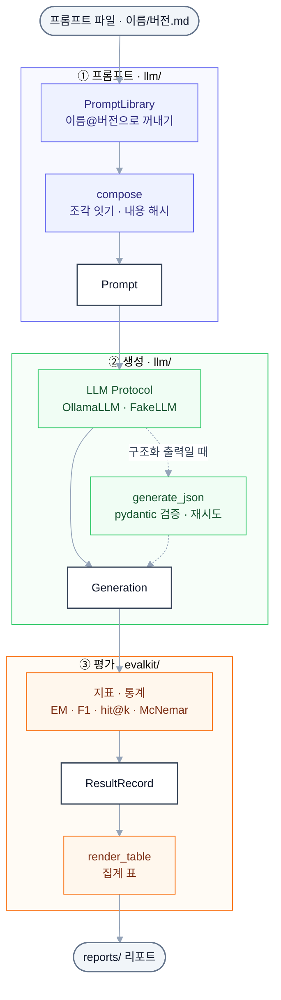

# llm-playground-llm

llm-playground 프로젝트들이 함께 쓰는 LLM · 평가 모듈의 uv workspace입니다. 메시지와 모델 설정(`ModelSpec`)을 받아 Ollama로 답을 만드는 `playground_llm`과, 검색 · 답변 결과를 지표 · 통계 · 리포트로 바꾸는 `playground_evalkit` 두 패키지를 둡니다. 두 패키지는 서로 의존하지 않고 제품 레포도 import하지 않으며, 벤치(`bench/f4_bench.py`)는 llm-playground-wiki가 만든 문항 세트를 파일로만 받습니다.

## 전체 흐름



## 폴더 구조

```
llm-playground-llm/
├─ packages/
│  ├─ llm/            playground_llm — 계약(protocols) · 타입(types) · 예외(errors) · FakeLLM(fake) · OllamaLLM(ollama) · generate_json(structured) · 프롬프트(prompts)
│  └─ evalkit/        playground_evalkit — 지표(metrics · answers) · 통계(stats) · KorQuAD(korquad) · 정규화(normalize) · 기록(records) · 리포트(report). 의존 없음
├─ bench/
│  ├─ f4_bench.py     F4 LLM 벤치 — 검색 결과를 고정하고 LLM만 바꿔 근거 답변을 잼
│  ├─ prompts/        벤치 전용 프롬프트 (f4_rag · f4_norag · f4_question_rag · f4_question_norag)
│  └─ data/           세트 · 모델 출력 원문 (git 제외)
├─ models/            선정 결과 yaml (gemma4-12b.yaml)
├─ reports/           벤치 결과 — 집계 지표만 커밋
├─ tests/             패키지별 테스트 (llm · evalkit · bench)
├─ .ruff/             공유 ruff 설정 복사본 (직접 고치지 않음)
├─ pyproject.toml     workspace 루트 · 개발 의존성 (uv)
└─ ruff.toml          ruff 설정
```

## 기술 스택

| 구분 | 사용 |
| --- | --- |
| 언어 · 환경 | Python 3.13 이상, uv workspace |
| LLM 서버 | Ollama 네이티브 `/api/chat` (OpenAI 호환 `/v1`이 아니라 `think` · `options.num_ctx`를 넘길 수 있는 네이티브 API) |
| LLM 클라이언트 | httpx (`[ollama]` extras) |
| 구조화 출력 | pydantic (`[json]` extras) |
| 평가 | 표준 라이브러리만 (`playground_evalkit`은 의존 없음) |

## 빠르게 실행해 보기

[uv](https://docs.astral.sh/uv/)를 설치한 상태에서 시작합니다. 실제 모델을 부르는 3단계에만 [Ollama](https://ollama.com/download)가 필요합니다.

### 1. 패키지 설치

```bash
uv sync --all-packages
```

`packages/` 아래 두 패키지와 extras(`[ollama]` · `[json]`), 개발 도구(pytest · ruff)를 함께 설치합니다.

### 2. 서버 없이 호출해 보기

```bash
uv run python -c "
from playground_llm import FakeLLM, Message, ModelSpec
spec = ModelSpec('ollama', 'gemma4:12b', {'temperature': 0.1, 'max_tokens': 512})
generation = FakeLLM(['서울입니다.']).generate(spec, [Message('user', '조선의 수도는?')])
print(spec.spec_id)
print(generation.text)
"
```

`FakeLLM`은 정해 둔 답을 돌려주는 테스트용 LLM입니다. `ollama/gemma4:12b?max_tokens=512,temperature=0.1`과 `서울입니다.`가 나오면 준비 완료이고, 첫 줄의 `spec_id`가 벤치 · 평가 기록의 키입니다.

### 3. (선택) Ollama로 호출해 보기

```bash
ollama pull gemma4:12b
uv run python -c "
from playground_llm import Message, ModelSpec
from playground_llm.ollama import OllamaConfig, OllamaLLM
spec = ModelSpec('ollama', 'gemma4:12b', {'temperature': 0.1, 'max_tokens': 512})
with OllamaLLM.connect(OllamaConfig.from_env()) as llm:
    print(llm.generate(spec, [Message('user', '조선의 수도는?')]).text)
"
```

실행 중인 Ollama에서 답을 받아 출력합니다. 받아 두지 않은 모델이면 `ModelNotFoundError`, 서버에 연결하지 못하면 `GenerationError`가 납니다.

## 설정

`OllamaConfig.from_env()`가 읽는 값입니다. 쓰지 않으면 기본값으로 동작합니다.

| 항목 | 변수 | 값 | 없으면 |
| --- | --- | --- | --- |
| Ollama 주소 | `OLLAMA_URL` (없으면 `OLLAMA_HOST`) | URL 또는 `host:port` | `http://localhost:11434` |
| 읽기 시간 제한 | `OLLAMA_TIMEOUT` | 초. 스트리밍은 조각 사이 간격에 걸림 | 120초 |

## 사용법

### 설치

제품 레포의 `pyproject.toml`에 패키지별 태그로 적습니다.

```toml
[tool.uv.sources]
playground-evalkit = { git = "https://github.com/calm-sea-psy/llm-playground-llm", tag = "evalkit-v0.3.0", subdirectory = "packages/evalkit" }
playground-llm = { git = "https://github.com/calm-sea-psy/llm-playground-llm", tag = "llm-v0.3.0", subdirectory = "packages/llm" }
```

이 레포와 함께 고칠 때는 같은 부모 폴더에 나란히 clone 하고 잠깐 path로 바꿔 씁니다: `{ path = "../llm-playground-llm/packages/evalkit", editable = true }` (`playground-llm`은 `packages/llm`). 0.x 동안은 깨는 변경이 있을 수 있습니다. 태그는 패키지별 접두사(`evalkit-v…` · `llm-v…`)를 씁니다.

### playground_llm

프롬프트 텍스트는 쓰는 제품 레포가 갖고, 이 패키지는 다루는 법만 제공합니다. 아래 예시는 서버 없이 돌아갑니다.

```python
from playground_llm import FakeLLM, Message, ModelSpec, PromptTemplate, compose
from playground_llm.structured import generate_json
from pydantic import BaseModel


class Answer(BaseModel):
    answer: str | None


spec = ModelSpec("ollama", "gemma4:12b", {"temperature": 0.1, "max_tokens": 512})
prompt = compose([PromptTemplate("qa", "v1", "질문: $question")], {"question": "조선의 수도는?"})
result = generate_json(
    FakeLLM(['{"answer": "한양"}']), spec, [Message("user", prompt.text)], Answer
)

print(prompt.version)  # qa@v1:60197d98 — 평가 기록의 prompt_version
print(result.value.answer, result.attempts)  # 한양 1
```

| 함수 · 클래스 | 역할 | 비고 |
| --- | --- | --- |
| `LLM` | `generate` · `stream` 계약 (Protocol) | 서버를 바꿀 때 구현체만 바꿈 |
| `ModelSpec(provider, name, params)` | 모델 하나 · 생성 설정 하나 | `spec_id`가 기록의 키. `with_params`로 일부만 바꾼 새 설정 |
| `Message(role, content)` | 대화 한 턴 | `system` · `user` · `assistant`. 이전 턴의 thinking은 넣지 않음 |
| `Generation` | 생성 결과 `text` · `thinking` · `usage` · `done_reason` | `as_message()`로 히스토리에 넣을 턴 |
| `StreamDelta(kind, text)` | 스트리밍 조각 | `kind`는 `thinking` · `text`. 끝에 `Generation`이 옴 |
| `Usage` | 토큰 수 · 시간 | 서버가 주지 않는 값은 `None` |
| `Think` | thinking 설정 | `off` · `on` · `low` · `medium` · `high` |
| `FakeLLM(replies)` | 서버 없는 테스트용 LLM | 받은 호출은 `calls`에 기록 |
| `OllamaLLM.connect(config)` | Ollama 클라이언트. `with`로 쓰면 끝날 때 닫음 | `playground_llm.ollama`에서 import (`[ollama]`) |
| `generate_json(llm, spec, messages, schema)` | JSON Schema 요구 → pydantic 검증 → `JsonGeneration` | `playground_llm.structured`에서 import (`[json]`). 기본 재시도 1번, `max_tokens`에 닿아 잘리면 재시도 없음 |
| `PromptTemplate(name, version, text)` | 프롬프트 파일 하나. 자리표시자는 `$name` | `ref`는 `이름@버전`, `digest`는 본문 sha256 앞 8자 |
| `PromptLibrary.load(directory)` | `{이름}/{버전}.md`를 모두 읽음 | `get("이름@버전")`, 버전 생략 불가 |
| `compose(parts, values)` | 조각을 채워 이은 `Prompt` | `version`은 `이름@버전:해시`를 `+`로 이은 값 |
| `ModelNotFoundError` · `GenerationTimeoutError` · `GenerationError` · `StructuredOutputError` · `PromptError` | 예외. 모두 `LLMError` 하위 | `GenerationTimeoutError` · `StructuredOutputError`는 `GenerationError` 하위 |

`OllamaLLM`은 `think`를 항상 명시해서 보냅니다. gemma4처럼 thinking을 지원하는 모델은 `think`를 빼면 켜진 채로 돌기 때문에, spec에 없으면 `false`를 보냅니다. 모델이 받지 않는 값(`THINK_RULES`)은 서버에 보내기 전에 `ValueError`로 거부합니다.

### playground_evalkit

```python
from playground_evalkit import exact_match, f1, hit_at_k, mrr, wilson_interval

print(exact_match("서울", ["서울"]), f1("서울특별시", ["서울"]))  # 1.0 0.5714285714285715
ranked = [[False, True], [False, False]]  # 문항마다 순위별 정답 여부
print(hit_at_k(ranked, 1), hit_at_k(ranked, 2), mrr(ranked))  # 0.0 0.5 0.25
print(wilson_interval(0, 30))  # (0.0, 0.11351339317396873)
```

| 함수 · 클래스 | 역할 | 비고 |
| --- | --- | --- |
| `hit_at_k(ranked_relevance, k)` · `mrr(ranked_relevance)` · `reciprocal_rank(row)` | 검색 지표 | |
| `percentile(values, q)` | 지연 백분위수 | `q`는 0~100, 선형 보간 |
| `exact_match(prediction, answers)` · `f1(prediction, answers)` · `normalize_answer(text)` | 답변 지표 | KorQuAD 1.0 공식 EM · 문자 F1 |
| `wilson_interval(successes, total)` | 비율의 Wilson 구간 | 기본 95% |
| `mcnemar_exact(correct_a, correct_b)` | McNemar 정확 검정 → `McNemarResult` | 엇갈린 문항만 봄 |
| `paired_bootstrap(scores_a, scores_b)` | 짝지은 평균 차이 구간 → `PairedBootstrap` | 기본 2000회 · seed 0 |
| `load_korquad(path, title_aliases=…)` · `KorQuADItem` | KorQuAD 1.0 JSON 로더 | |
| `contains_answer(title, text, item)` | 제목 일치 + 공백 무시 정답 포함 | 검색 평가의 정답 판정 |
| `normalize_title(title)` · `korquad_title(title)` · `squash(text)` | 제목 · 공백 정규화 | |
| `ResultRecord` · `write_records(path, records)` · `read_records(path)` | 문항별 점수 jsonl | 질문 · 정답 · 모델 출력 원문은 남기지 않음 |
| `render_table(rows, columns)` | 마크다운 표 | 소수는 3자리까지 |

## 명령어

F4 LLM 벤치(`bench/f4_bench.py`)입니다. llm-playground-wiki의 `scripts/build_bench_set.py` · `build_bench_extra.py` · `build_longtail_set.py`가 만든 세트(`bench/data/{세트}/items.jsonl`)를 입력으로 받습니다.

| 명령 | 옵션 | 설명 |
| --- | --- | --- |
| `f4_bench.py run` | `--run-id` (필수) · `--set` (여러 번 가능) · `--specs` · `--think` · `--limit` · `--paraphrase-rag` · `--data` (기본 `bench/data`) | spec × 모드(rag · norag) × 문항마다 `generate_json`으로 답을 받아 `bench/data/runs/{run_id}/outputs.jsonl`에 이어 씀. 끝난 문항은 건너뜀 |
| `f4_bench.py score` | `--run-id` (필수) · `--pair A B` · `--stage` · `--data` | 자동 채점 → `records.jsonl`(문항 id별 점수) · `reports/{run_id}.md`(집계) |

```bash
uv run python bench/f4_bench.py run --set f4-korquad-xxxxxxxx --run-id smoke --specs gemma4:12b --limit 5
```

`--limit 5`는 종류마다 앞 5문항만 돌리는 시험 실행입니다. `f4-korquad-xxxxxxxx`는 위키 레포가 만든 세트 폴더 이름으로 바꿉니다.

```bash
uv run python bench/f4_bench.py score --run-id 2026-10-25-f4-stage2 --stage 2단계 --pair gemma4:12b qwen3.5:9b
```

`--pair`는 think off spec 둘을 문항마다 짝지은 비교(A − B) 절을 리포트에 더합니다. 채점은 전부 자동이고 거절은 문구가 아니라 `answer`가 `null`인지로만 셉니다. `bench/data/`는 git에서 제외합니다 (KorQuAD CC BY-ND — 질문 · 문맥 · 모델 출력 원문은 로컬에만 둡니다).

## 테스트

```bash
uv run pytest
uv run ruff check
```

서버 없이 돌아갑니다. 실제 Ollama를 부르는 live 테스트는 GPU를 쓰므로 기본으로 건너뛰고, `LLM_LIVE_TESTS=1`일 때만 돕니다. 모델은 `OLLAMA_TEST_MODEL`(기본 `gemma4:12b`)로 바꿉니다. CI(`.github/workflows/ci.yml`)는 `main` push와 PR에서 ruff · pytest를 돌리고, `.github/workflows/pr-lint.yml`은 PR 제목 · 본문 규칙을 검사합니다.

## 실험 결과

답변 LLM을 고른 F4 벤치입니다. 1단계([reports/2026-10-24-f4-stage1.md](reports/2026-10-24-f4-stage1.md))에서 spec 10개를 결선 후보 둘로 줄이고, 결선([reports/2026-10-25-f4-stage2.md](reports/2026-10-25-f4-stage2.md))에서 **gemma4:12b · think off**를 골랐습니다. 선정 기록은 [models/gemma4-12b.yaml](models/gemma4-12b.yaml)에 있습니다. 검색 결과를 고정한 문항이라 end-to-end 정확도가 아닙니다.

| 지표 (단위 %, 지연 ms) | gemma4:12b | qwen3.5:9b | 범위 |
| --- | --- | --- | --- |
| KorQuAD F1 | 86.7 | 86.0 | 1단계 |
| 문서 없음 위반 | 26.0 | 18.0 | 1단계 (n 50) |
| 롱테일 F1 | 78.7 | 75.1 | 1 + 2단계 합산 (n 400) |
| 롱테일 EM (띄어쓰기 무시) | 59.5 | 56.8 | 1 + 2단계 합산 (n 400) |
| 사실 없음 위반 (문자열 null 뺌) | 13.0 | 9.0 | 1 + 2단계 합산 (n 300) |
| p50 지연 | 1103 | 698 | 2단계 |

차이는 100문항당 3~4문항으로 작고 엇갈립니다. 답 있음 정답률과 한국어 표기(날짜 띄어쓰기 · 글자 "null"이 없음)를 사실 없음 위반 · 지연보다 앞에 뒀습니다. 재현 명령은 각 리포트 끝에 있습니다.
